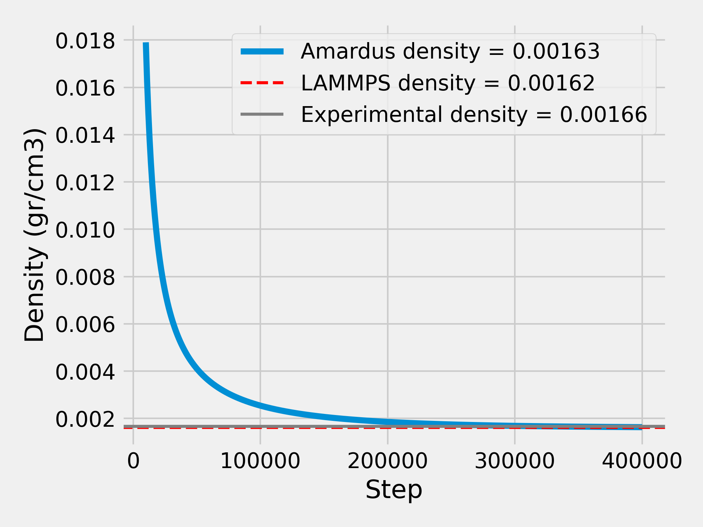
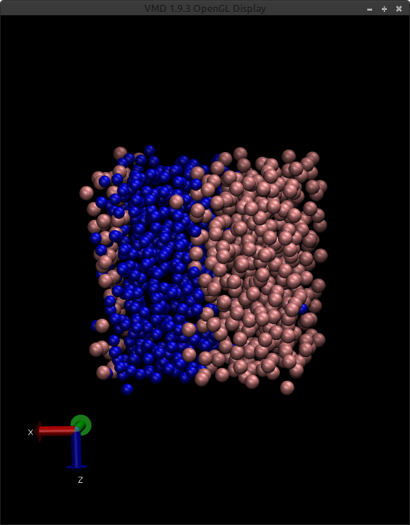
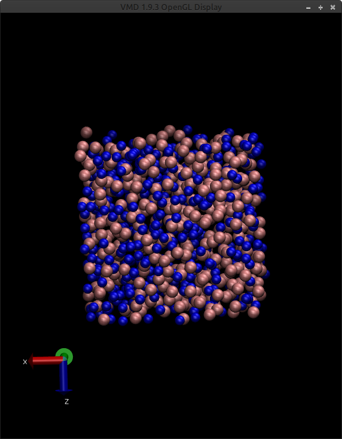
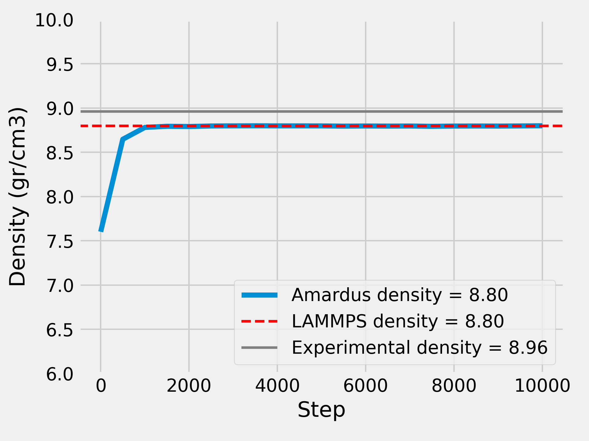
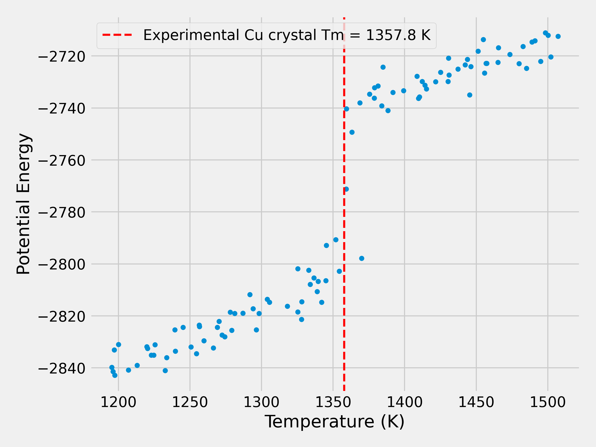

# Amardus


> *Amardus* is the Greek name for the *Sefid-Rud*, a long river in northern Iran historically known for its abundant fish.

This is a personal project intended for learning, experimentation, and understanding the concepts and algorithms behind modern molecular dynamics (MD) engines. 


**Implemented:**

- [x] [Linear-scaling MD](https://github.com/hghcomphys/linear-md) based on linked cell and Verlet list
- [x] Verlet, langevin, and Leapfrog integrators
- [x] NVE, NVT, and NPT ensembles (Brendsen)
- [x] Non-bonded short-range interaction (Lennard-Jones)
- [x] Metals (EAM potential) 
- [x] Energy minimization (Gradient Descent)
- [ ] Molecules 
- [ ] Bonded interactions (bonds, angles, dihedrals)
- [ ] Long-range interaction (Coulomb)
- [ ] Constraints (SHAKE, RATTLE)
- [ ] Free energy calculation (MBAR)
- [ ] Parallelization (OpenMP, MPI)
- [ ] CHARMM/AMBER FF
- [ ] Machine-learning FF 
- [ ] GPU-acceleration


## Pixi Environment

**Setup:**

```bash
git clone https://github.com/hghcomphys/amardus.git && cd amardus
pixi install 
pixi shell
```
This clones the repo, creates and activates the project environment. 

**Launch JupyterLab:**

```bash
pixi run jupyter-lab 
```


## Example 1: Lennard-Jones Potential

The example below shows how to perform MD simualtion using Lennard-Jones potential.

```python
# Parameters correspond to the LJ interaction between argon atoms.
lennard_jones = LennardJonesPotential(
    cutoff_radius=cutoff,
    params=LennardJonesParams.from_list(
        epsilon=[e * unit.electronvolt for e in [0.01032]],  # Energy well depth
        sigma=[s * unit.angstrom for s in [3.405]],          # Characteristic distance
    ),
)

# Initialize the simulation system and configure the neighbor list.
system = System.create(
    atoms,
    neighbor_cutoff=cutoff,
    neighbor_skin=2.0 * unit.angstrom,  # Additional buffer for neighbor-list updates
    neighbor_max_atoms=300,             # Maximum number of atoms in the neighbor list
)

# Configure the thermostat to control the system temperature.
thermostat = BrendsenThermostat(
    temperature,
    thermostat_coupling_time,
)
# Configure the barostat to control the system pressure.
barostat = BrendsenBarostat(
    pressure,
    barostat_coupling_time,
    interval=1,  # Apply pressure coupling at every integration step
    compressibility=1.0 / (1e4 * unit.bar),
)

# Create a velocity-Verlet integrator with thermostat and barostat coupling.
verlet = VerletIntegrator(
    time_step=time_step,
    system_couplings=[
        thermostat,
        barostat,
    ],
)

# Configure simulation reporters.
state = StateReporter(interval=10_000, normalize=False)
xyz = XyzReporter("ar.xyz", atom_types_map, interval=1000)
csv = CSVReporter(
    "thermo-ar.csv",
    interval=1000,
    ignore_first_steps=10_000,
)

# Assemble the simulation with the system, integrator, force field, and reporters.
simulation = Simulation(
    system,
    verlet,
    forcefields=[lennard_jones],
    reporters=[state, xyz, csv],
)
simulation.step(400_000)
```

Output:

```text
Simulation(system=System(num_atoms=864), integration=VerletIntegrator(time_step=0.0982269, system_couplings=[BrendsenThermostat(target_temperature=300.0, coupling_time=0.9822690000000001, interval=1), BrendsenBarostat(target_pressure=6.2415e-07, coupling_time=0.9822690000000001, compressibility=160.21789633902108, interval=1)]), forcefields=[LennardJonesPotential(cutoff_radius=7.0)], reporters=[StateReporter(interval=10000), XyzReporter(interval=1000), CSVReporter(interval=1000)])

Step     Temp           Press          PotEng         KinEng         TotEng         AvgNgh         Density       
0        309.48533852   26.22931727    -67.86598555   34.56355945    -33.30242610   75.84490741    1.69921003    
10000    299.94141428   11.22482145    -0.67865880    33.49768669    32.81902789    0.88888889     0.01786043    
20000    300.05866100   5.66500229     -0.29524767    33.51078089    33.21553322    0.48611111     0.00910624    
...
400000   300.00464944   1.01669759     -0.04740522    33.50474884    33.45734361    0.08796296     0.00163121
```




### Simulating mixture of Ar and Ne atoms

```python
lennard_jones = LennardJonesPotential(
    cutoff_radius=cutoff,
    params=LennardJonesParams.from_list(
        epsilon=[e * unit.electronvolt for e in [0.01032, 0.00307]],
        sigma=[s * unit.angstrom for s in [3.405, 2.789]],
    ),
)

# Defining system, reporters, etc.
# ...

langevin = LangevinIntegrator(
    time_step=time_step,
    damping_time=10 * time_step,
    temperature=temperature,
    system_couplings=[
        # barostat,
    ],
)

simulation = Simulation(
    system,
    langevin,
    forcefields=[lennard_jones],
    reporters=[state, xyz, csv],
)
simulation.step(100_000)
```

Output:

```text
Simulation(system=System(num_atoms=864), integrator=LangevinIntegrator(time_step=0.0982269, damping_time=0.9822690000000001, temperature=300.0, system_couplings=[]), forcefields=[LennardJonesPotential(cutoff_radius=7.0)], reporters=[StateReporter(interval=10000), XyzReporter(interval=1000), CSVReporter(interval=1000)], energy_minimizer=GradientDescentEnergyMinimizer(max_steps=10000, force_tolerance=0.001, step_size=0.005))

Step     Temp           Press          PotEng         KinEng         TotEng         AvgNgh         Density       
0        309.48533852   99.05526351    -34.87707431   34.56355945    -0.31351486    78.00000000    1.24471987    
10000    310.87809168   4259.65540958  -18.06343478   34.71910319    16.65566841    76.53009259    1.24471987    
20000    289.88411665   4072.07466998  -17.59291636   32.37447999    14.78156363    76.98611111    1.24471987    
...
100000   299.33541346   3995.29557864  -15.87360252   33.43000805    17.55640553    78.30324074    1.24471987    
```

Initial configuration      |  After 100ps 
:-------------------------:|:-------------------------:
  |  


See [this](examples/01_lj_Ar.ipynb) example notebook for more details.


## Example 2: EAM potential

Perform MD simulations using an EAM potential.

```python

cu_prams = EAMParams(
    A=0.391865 * unit.electronvolt * unit.angstrom**-1,
    d=4.32 * unit.angstrom,
    c=4.29 * unit.angstrom,
    c0=10.18724 * unit.electronvolt * unit.angstrom**-2,
    c1=-12.82033 * unit.electronvolt * unit.angstrom**-3,
    c2=6.176587 * unit.electronvolt * unit.angstrom**-4,
    c3=-1.341391 * unit.electronvolt * unit.angstrom**-5,
    c4=0.109842 * unit.electronvolt * unit.angstrom**-6,
    B=-0.881096 * unit.angstrom**-2,
)
eam = EAMPotential(
    cutoff_radius=cutoff, 
    params=cu_prams,
)

# Defining system, integrator, reporters, etc.
# ...

simulation = Simulation(
    system,
    verlet,
    forcefields=[eam],
    reporters=[state, xyz, csv],
)
print(simulation)
simulation.step(10_000)
```

Output:

```text
Simulation(system=System(num_atoms=864), integration=VerletIntegrator(time_step=0.0982269, system_couplings=[BrendsenThermostat(target_temperature=300.0, coupling_time=0.9822690000000001, interval=1), BrendsenBarostat(target_pressure=6.2415e-07, coupling_time=9.822690000000001, compressibility=1.079635420074266, interval=1)]), forcefields=[EAMPotential(cutoff_radius=5.3)], reporters=[StateReporter(interval=1000), XyzReporter(interval=1000), CSVReporter(interval=500)])
Step     Temp           Press          PotEng         KinEng         TotEng         AvgNgh         Density       
0        309.48533852   -94691.59550559 -2915.40564786 34.56355945    -2880.84208841 134.00000000   7.60175267    
1000     296.18734589   587.25413779   -2975.89293168 33.07842945    -2942.81450223 131.02083333   8.78069800    
2000     305.03876377   161.81549619   -2979.96732333 34.06696258    -2945.90036075 130.91203704   8.79121797    
...
10000    298.48509271   614.07093489   -2979.54909996 33.33504358    -2946.21405638 131.10416667   8.79969493
```



### Calculating Melting temperature

To estimate the melting temperature using the temperature annealing method. 
The system is gradually heated while monitoring its potential energy. 
A sudden change in the potential-energy trend indicates the solid-to-liquid phase transition, allowing the melting temperature to be calculated.


```python
# Start writing thermodynamic data to the CSV file.
simulation.reporters = [
    state, 
    CSVReporter("thermo-cu-melting.csv", interval=500, ignore_first_steps=1000),
]

Tstart, Tend = 1200, 1500
Trange = np.linspace(Tstart, Tend, 50)
for Tvar in Trange:
    # Update the thermostat target temperature.
    simulation.integrator.system_couplings[0].target_temperature = Tvar
    # Run the simulation for 1,000 steps at the current temperature.
    simulation.step(1_000)
```

Output:

```text
11000    1197.07977432  2073.82227820  -2833.11424717 133.69078530   -2699.42346188 124.28240741   8.15034607    
12000    1196.17957111  -218.27925100  -2841.36485837 133.59024991   -2707.77460846 124.71064815   8.16207752    
13000    1213.00482726  1940.08119009  -2838.98997520 135.46930740   -2703.52066781 124.25694444   8.14533527    
...
60000    1507.19794393  1988.75405510  -2712.44995945 168.32501981   -2544.12493964 116.65509259   7.68418077
```



See [this](examples/02_eam_Cu.ipynb) example notebook for more details.
